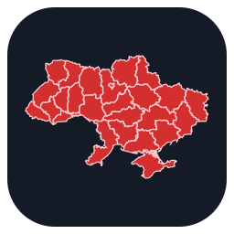
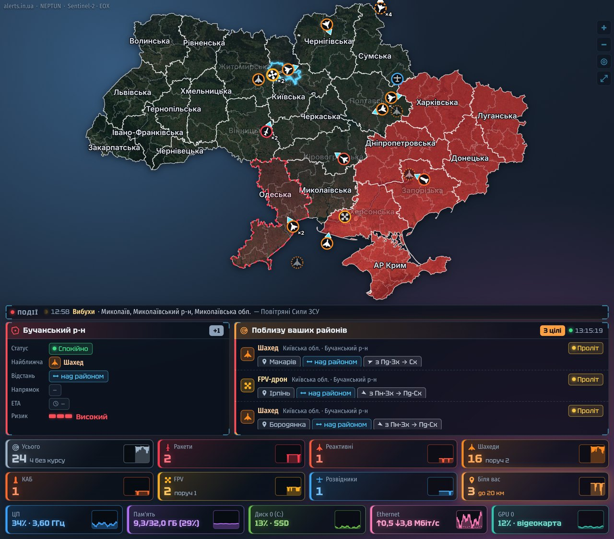
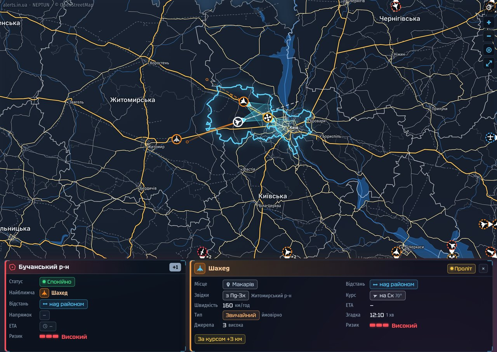
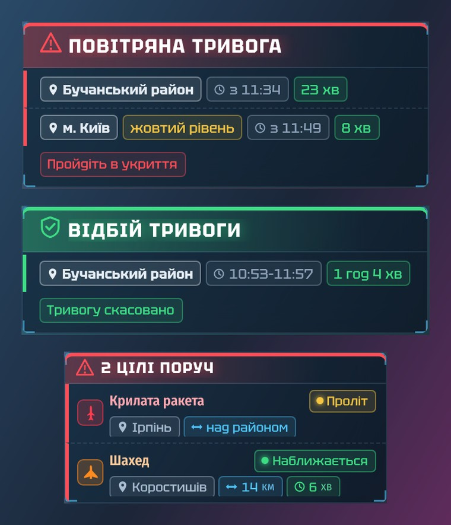
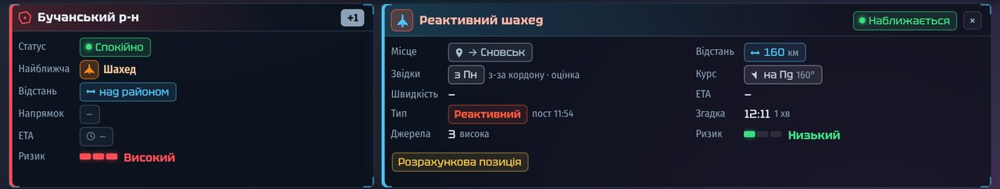
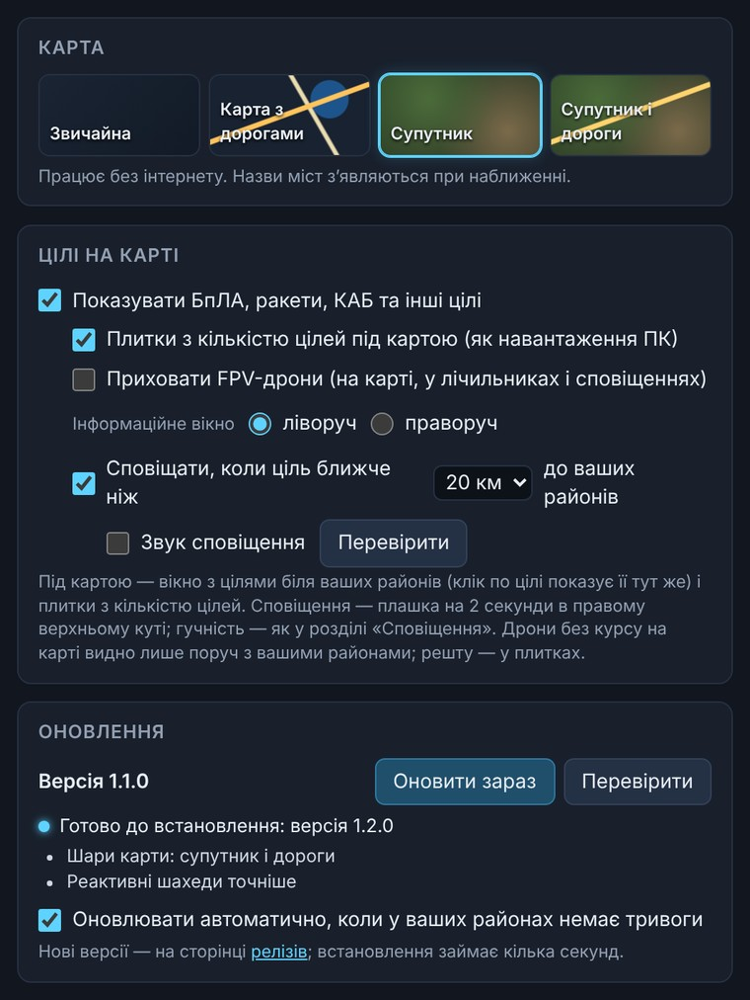

<div align="center">



# Карта тривог

**Жива карта України для робочого столу Windows.**<br>
Тривоги по кожному району, а шахеди, ракети й КАБи видно в небі в реальному часі. Віджет одразу показує, що летить біля вас.

[](https://github.com/steblak123/trevoga-map/releases/latest/download/trevoga-map-setup.exe)
[](https://github.com/steblak123/trevoga-map/releases/latest)
[](https://github.com/steblak123/trevoga-map/releases)



</div>

## Що вміє

| | |
| --- | --- |
| 🗺️ **Кожен район** | 136 районів і всі області. Червоний і жовтий рівні тривоги. При наведенні видно, з якого часу тривога, які загрози та коли була остання. |
| 🛩️ **Цілі в небі** | Шахеди (реактивні окремо), ракети, балістика, КАБ, авіація, розвідники, FPV, морські дрони. Клік по цілі показує, звідки вона летить і куди. Скупчення об’єднуються в одну мітку «×N». Наведіть на ціль — і побачите **джерела**: які канали про неї писали, о котрій і що саме. |
| 💥 **Вибухи** | Коли канали пишуть про вибухи в місті, на карті 40 хвилин видно значок. Наведіть — побачите, хто написав. |
| 📰 **Стрічка подій** | Один рядок під картою: тривоги й відбої, нові цілі, вибухи — «Тривога · Чугуївський р-н, Харківська обл. — alerts.in.ua». |
| 📡 **Ваші канали Telegram** | Додайте в налаштуваннях публічні канали свого міста (наприклад, t.me/krop_vanek). Віджет читає їхні пости й веде маршрут цілі від поста до поста: «Реактивний на Новий Стародуб» → «→Нова Прага» → «В бік Аджамки». У картці цілі видно маршрут, а шахед без курсу отримує курс із каналу. |
| 🎯 **Що біля вас** | Під картою вікно з цілями поруч із вашими районами: відстань, напрямок, ETA і ризик. Клік по цілі відкриває її картку. |
| 🔔 **Тихі сповіщення** | Плашка на 5 секунд при тривозі, відбої та коли ціль ближче ніж 5 / 10 / 20 / 50 км. Напівпрозора, крізь неї проходять кліки, звук за бажанням. У режимі «Акуратний» — без підсвітки. |
| 🛰️ **Супутник і дороги** | П’ять підкладок: звичайна, карта з дорогами, супутник, супутник із дорогами, темний супутник. Працюють **без інтернету**. Зум до 100× кнопками, колесом і тачпадом. При наближенні з’являються назви районів, міст і сіл, а з інтернетом — детальний супутник. |
| 📊 **Плитки й навантаження ПК** | Кількість цілей за типами з графіком за 30 хвилин. Поруч ЦП, пам’ять, диски, мережа та відеокарта, як у Диспетчері завдань. Вигляд — «Яскравий» або «Акуратний», без підсвітки. |
| ⚡ **Оновлюється сам** | Нові версії приходять з GitHub і встановлюються за кілька секунд, коли у ваших районах немає тривоги. |
| 🪶 **Не заважає** | Прозорий фон: живе на робочому столі над ярликами або під ними, як шпалери. Кліки повз карту проходять крізь неї. |

<table>
  <tr>
    <td width="58%"></td>
    <td></td>
  </tr>
  <tr>
    <td></td>
    <td></td>
  </tr>
</table>

## Встановлення — 2 хвилини

1. **Завантажте** [`trevoga-map-setup.exe`](https://github.com/steblak123/trevoga-map/releases/latest/download/trevoga-map-setup.exe) і запустіть.
   Якщо Windows покаже «Windows захистив ваш ПК», натисніть **Докладніше → Однаково запустити**. Так буває з усіма програмами без платного сертифіката підпису; код відкритий, його можна перевірити тут.
2. **Отримайте безкоштовний токен** для даних про тривоги: [форма на devs.alerts.in.ua](https://devs.alerts.in.ua/). Обов’язково дайте відповідь на лист, інакше токен не запрацює.
3. Під час першого запуску відкриються налаштування. **Вставте токен і позначте свої райони.** Готово.

Налаштування відкриваються подвійним кліком по карті, через ⚙ або з меню значка в треї.
Вони зберігаються в `%APPDATA%\trevoga-map\settings.json`.

## Оновлення

Віджет сам перевіряє нові версії на GitHub: за хвилину після запуску й далі кожні 6 годин.
Нову версію він завантажує у фоні й встановлює тихо, коли у ваших районах немає тривоги. Після цього віджет за кілька секунд повертається.
Усе це можна вимкнути в **Налаштування → Оновлення**. Там же є кнопки «Перевірити» й «Оновити зараз», а ще є пункт у меню трею.

## Часті питання

<details><summary><b>Це безпечно?</b></summary>

Код повністю відкритий. Віджет лише читає публічні дані про тривоги й цілі та нічого про вас не надсилає.
Ваш токен зберігається тільки на вашому комп’ютері.
</details>

<details><summary><b>Навіщо токен і чому його не вшито?</b></summary>

Дані про тривоги дає API alerts.in.ua за персональним токеном. Правила API забороняють передавати один токен багатьом людям, тому кожен отримує свій. Це безкоштовно.
</details>

<details><summary><b>Звідки відомо, де шахеди і які з них реактивні?</b></summary>

Положення цілей береться з відкритого API NEPTUN, який збирає повідомлення моніторингових каналів.
Реактивний шахед від звичайного віджет відрізняє так:
- за описом цілі від NEPTUN;
- за свіжими постами каналів про те саме місце;
- за швидкістю (звичайний летить до ~185 км/год).

У картці цілі видно, на чому ґрунтується висновок. Наведіть на ціль, і підказка покаже канали, які про неї писали: час і рядок із поста. У картці цілі ці канали можна клікнути.
</details>

<details><summary><b>Працює без інтернету?</b></summary>

Карта, райони й усі підкладки (супутник, дороги, міста) вбудовані в програму. Тривогам і цілям, звісно, потрібен інтернет.
</details>

<details><summary><b>Як видалити?</b></summary>

Параметри Windows → Програми → «Карта тривог» → Видалити. Автозапуск прибирається разом із програмою.
</details>

## Для розробників

Потрібен Node.js 20+.

```bash
npm install
npm start            # запуск віджета з вихідного коду
npm test             # тести читання постів каналів на тижні справжніх постів
npm run dist         # інсталятор dist/trevoga-map-setup.exe (локально)
```

Без інсталятора: `scripts\install.bat` встановить залежності, додасть автозапуск і запустить віджет.
Така git-копія теж оновлюється сама: віджет робить `git fetch` і, якщо у папці немає власних змін, підтягує нові коміти та перезапускається.

**Випуск нової версії.** Інсталятор збирає GitHub Actions ([`.github/workflows/release.yml`](.github/workflows/release.yml)), і всі встановлені віджети отримують його самі. Запустити збірку можна двома способами:
- тегом:
  ```bash
  git tag v1.2.0
  git push origin v1.2.0
  ```
- кнопкою на GitHub: **Actions → Release → Run workflow**.

Що нового береться з розділу `## 1.2.0` у [`CHANGELOG.md`](CHANGELOG.md).

**Без GitHub Actions** (наприклад, коли вони недоступні для акаунта) — зібрати на своєму Windows і викласти вручну:
1. `npm run release:local` — збирає `dist\trevoga-map-setup.exe`, `.blockmap` і `latest.yml` (вбудований токен перед збіркою видаляється).
2. GitHub → **Releases → Draft a new release**, тег `vX.Y.Z` (та сама версія, що в `package.json`), текст — з `CHANGELOG.md`,
   прикріпити ці три файли → **Publish release**. Автооновлення читає `latest.yml` з останнього релізу.

| Папка | Що там |
| --- | --- |
| `app/` | віджет, налаштування, плашки тривог, головний процес Electron |
| [`app/neptun/`](app/neptun/README.md) | шар цілей, вікно під картою, плитки, зум, підкладки карти |
| `app/update/` | автооновлення (GitHub Releases або git) |
| `build/` | збірка карти районів (`make-map.js`) і підкладок (`make-basemap.py`) |

Як усе влаштовано зсередини, описано в [`app/neptun/PROMPT.md`](app/neptun/PROMPT.md), план розвитку — у [`docs/PLAN.md`](docs/PLAN.md).

## Відмова від відповідальності

Віджет неофіційний і має лише інформаційний характер. Дані можуть надходити із затримкою.
**Не покладайтеся на нього як на єдине джерело оповіщення:** користуйтеся офіційними застосунками («Повітряна тривога», «Дія») та сиренами.

## Джерела даних і ліцензії

- Код — [MIT](LICENSE).
- Тривоги — [alerts.in.ua](https://alerts.in.ua), за [умовами використання](https://alerts.in.ua/terms-of-usage).
- Цілі — [NEPTUN](https://neptun.in.ua/), за [умовами API](https://neptun.in.ua/api-terms).
- Межі районів — OCHA / HDX, [CC BY-IGO](https://creativecommons.org/licenses/by/3.0/igo/).
- Підкладки карти:
  - супутник — Sentinel-2 cloudless by EOX, [CC BY 4.0](https://creativecommons.org/licenses/by/4.0/);
  - дороги й міста — © [OpenStreetMap](https://www.openstreetmap.org/copyright), ODbL;
  - вода й забудова — Natural Earth.

  Подробиці — у [`app/neptun/basemap/LICENSE.md`](app/neptun/basemap/LICENSE.md).
- Шрифти Tektur і Fira Sans Condensed — SIL Open Font License.

Посилання на джерела показані дрібним текстом у куті карти: цього вимагають умови API та ліцензії карт.
